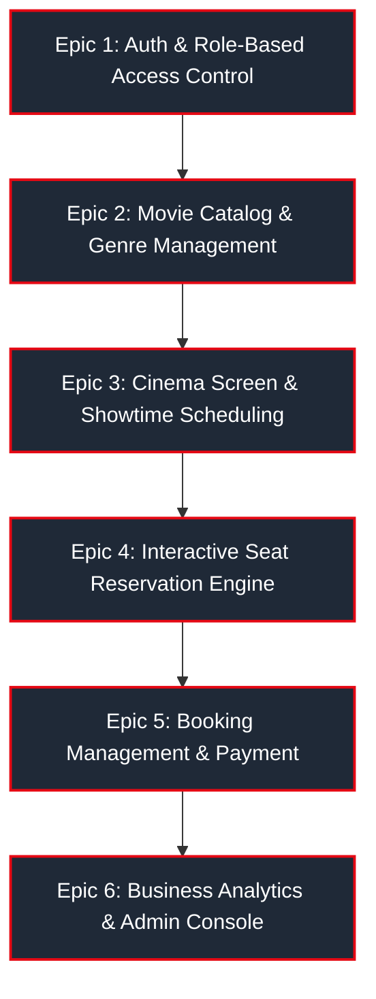

# 🎬 IMovies - Online Cinema Ticket Booking & Real-Time Seat Reservation Platform

> A seamless online platform that enhances the cinema experience by allowing users to browse movies, select showtimes, and reserve seats with real-time availability tracking. Built with React.js, Express.js, and MongoDB, it leverages a robust client-server architecture to ensure efficient data management and smooth performance. Key features include secure user authentication, booking management, interactive seat maps, and an intuitive interface that makes ticket reservations convenient and personalized.

---

## 📌 Project Overview & Metadata

- **Project Title:** IMovies Web-Application
- **Domain:** Cinema Ticket Booking & Box Office Management
- **Architecture:** MERN Client-Server Architecture (MongoDB, Express.js, React.js, Node.js)
- **UI Framework:** Bootstrap 5 & Bootstrap Icons
- **Authentication:** JSON Web Tokens (JWT) & Bcrypt Password Hashing
- **Mentor:** Pending Assignment
- **Project Stats:**
  - **Total Epics:** 6
  - **Total Tasks:** 19
  - **Total Subtasks:** 0

---

## 🛠️ Skills & Technologies Required

| Technology / Skill | Purpose & Usage in IMovies |
| :--- | :--- |
| **HyperText Markup Language (HTML5)** | Semantic structure, accessible document markup, and modal overlays. |
| **Cascading Style Sheets (CSS3)** | Custom dark cinema theme, glowing curved screen animation, seat layout grid, and print styling for E-tickets. |
| **JavaScript (ES6+)** | Core language for business logic, asynchronous promises, array transformations, and event listeners. |
| **React.js (v18)** | Component-driven frontend, custom hooks, dynamic state management, context API, and client-side routing. |
| **Node.js (v18+)** | High-performance asynchronous JavaScript runtime environment for backend services. |
| **Express.js (v4)** | RESTful API routing, middleware pipeline, CORS management, and error handling. |
| **MongoDB / Mongoose (v8)** | Schema modeling, relational population, queries, and built-in zero-latency in-memory fallback. |
| **Asynchronous JavaScript** | Async/Await, non-blocking I/O operations, concurrent seed processes, and API integrations. |
| **JSON Web Token (JWT)** | Stateless user authentication, bearer token verification, and role authorization. |
| **Bootstrap 5 & Icons** | Responsive 12-column grid system, modals, badges, cards, navigation, and SVG iconography. |

---

## 💻 System Requirements

### 1. Software Requirements
To ensure smooth development, deployment, and usage of the IMovies Web-Application, the following software prerequisites must be met:
- **Operating System:** Windows 10/11, macOS, or Linux (cross-platform support).
- **Node.js:** v16.0.0 or above (v20+ recommended) — Powers server-side logic and React frontend bundling.
- **npm:** v8.0.0 or above — Dependency management for client and server packages.
- **React.js:** v18.3+ — Component-based UI framework.
- **Express.js:** v4.21+ — Lightweight web server and RESTful routing engine.
- **MongoDB:** Community Edition or MongoDB Atlas (Includes zero-config fallback in-memory datastore for instant testing).
- **Browser:** Google Chrome, Mozilla Firefox, Microsoft Edge, or Apple Safari (latest versions).
- **API Tooling:** Postman / cURL for REST API verification.
- **Code Editor:** Visual Studio Code or WebStorm.

### 2. Hardware Requirements
- **Processor:** Intel Core i5 (8th Gen or above) / AMD Ryzen 5 or Apple Silicon (M1/M2/M3/M4).
- **RAM:** Minimum 8 GB (16 GB recommended) for concurrent dev servers and browser testing.
- **Storage:** Minimum 1 GB available disk space for Node dependencies and local assets.
- **Display Resolution:** 1366x768 or higher (Full HD 1920x1080 recommended).

---

## 📊 Comprehensive Breakdown: 6 Epics & 19 Core Tasks



### **Epic 1: Authentication & Role-Based Access Control (RBAC)**
- **Task 1: User Model & Schema Design** — Secure User schema with fields for name, email (unique/lowercased), bcrypt-hashed password, phone, role (`customer`, `admin`), avatar, and timestamps.
- **Task 2: JWT Authentication Endpoints** — Stateless registration (`POST /api/auth/register`), login (`POST /api/auth/login`), and profile session verification (`GET /api/auth/me`).
- **Task 3: Profile Management & Protected Route Middleware** — Password hashing pre-save hooks, `protect` Bearer token verification middleware, `admin` role guard middleware, profile update, and password change endpoints.
- **Task 4: Frontend Auth Pages & Global State Context** — Responsive Login, Registration, and Profile pages built with Bootstrap 5, form validation, error banners, 1-click demo login buttons, and persistent React `AuthContext`.

---

### **Epic 2: Movie Catalog & Genre Management**
- **Task 5: Movie & Genre Schema Design** — Rich Movie model with title, synopsis, posterUrl, bannerUrl, trailerUrl, genre tags, duration (minutes), releaseDate, language, age rating (`PG-13`, `R`, `PG`), IMDb score, director, cast, and status (`Now Showing`, `Coming Soon`, `Archived`).
- **Task 6: Movie CRUD & Filtering REST APIs** — Dynamic retrieval endpoint (`GET /api/movies`) supporting multi-parameter queries: title keyword search, genre filtering, status categorization, and sort orders (IMDb rating, release date, alphabetical).
- **Task 7: Movie Catalog & Movie Details UI** — High-impact hero carousel with featured blockbusters, interactive genre pills, "Now Showing" and "Coming Soon" sections, and a detailed Movie Information page with trailer link, synopsis, cast, and screening selector.

---

### **Epic 3: Cinema Hall, Screen & Showtime Scheduling**
- **Task 8: Theater Screen & Showtime Models** — Cinema screen layout schema (Screen 1 - IMAX Laser, Screen 2 - Dolby Atmos, Screen 3 - RealD 3D) with row configurations (A to H), columns (8 cols per row), seat tier pricing (`VIP`, `Premium`, `Standard`), and Showtime model.
- **Task 9: Showtime Management & Schedule APIs** — Showtime listing APIs (`GET /api/showtimes`) filtered by movie and date, admin showtime scheduling with theater screen conflict checks, and deletion endpoints.
- **Task 10: Interactive Showtime Selector & Date Picker UI** — Dynamic date selector bar (Today, Tomorrow, and next 3 days), theater screen grouping cards, format badges, and clickable showtime buttons.

---

### **Epic 4: Interactive Seat Reservation & Real-Time Availability Engine**
- **Task 11: Seat Grid & Dynamic Reservation State Algorithm** — Real-time auditorium representation with 64 seats, color-coded seat tiers (VIP: Gold, Premium: Violet, Standard: Slate), center aisle walkways, and prevention of race conditions.
- **Task 12: Showtime Live Seat Availability API** — Dedicated endpoint (`GET /api/showtimes/:id/seats`) querying confirmed reservations to return the real-time seat matrix with `available` vs `booked` statuses.
- **Task 13: Interactive Seat Selection UI with Visual Screen Map** — Cinema curved glowing screen ("ALL EYES THIS WAY"), interactive seat click handlers, seat selection limits (maximum 8 seats), real-time price calculator, and seat legend.

---

### **Epic 5: Booking Management & Payment Processing**
- **Task 14: Booking Model & Ticket Schema** — Complete Booking schema with unique alphanumeric booking IDs (`IMV-YYYYMM-XXXXX`), references to user, movie, and showtime, selected seats array `{seatNumber, tier, price}`, subtotal, convenience fee, tax, payment method, and QR verification string.
- **Task 15: Booking Transaction & Simulated Payment APIs** — Atomic booking creation (`POST /api/bookings`) with collision detection that rejects already-reserved seats (HTTP 409 Conflict), mock payment processing, and booking cancellation with seat release (`PUT /api/bookings/:id/cancel`).
- **Task 16: Interactive Checkout & Digital E-Ticket Modal** — Checkout modal with payment options (Credit/Debit Card, Apple Pay, UPI, PayPal), simulated payment processing, and digital E-Ticket modal with notch cutouts, perforated divider, and QR code.
- **Task 17: User Booking History & Ticket Management Dashboard** — "My Tickets" guest dashboard with filters for Active and Cancelled bookings, ticket view modals, 1-click printable PDF receipts (`window.print()`), and booking cancellation.

---

### **Epic 6: Admin Management & Business Analytics Dashboard**
- **Task 18: Box Office Analytics & Business KPI Engine** — Aggregate intelligence endpoint (`GET /api/admin/stats`): Total Box Office Gross Revenue, Total Tickets Sold, Occupancy Rate (%), Active Theaters, Top Grossing Movies, and Recent Booking Activity stream.
- **Task 19: Admin Control Panel UI & Automated Database Seeder** — Complete Admin Dashboard with tabs for Box Office Analytics, Movie CRUD, Showtime Scheduler, and Master Bookings Ledger. Includes automated database seeder (`npm run seed`) with realistic movies, showtimes, sample bookings, and demo accounts.

---

## 🏛️ System Architecture

```
                    ┌────────────────────────────────────────────────────────┐
                    │                      CLIENT TIER                       │
                    │               React 18 + Bootstrap 5 UI                │
                    │  (Navbar, Catalog, SeatMatrix, Modals, Admin Console)  │
                    └───────────────────────────┬────────────────────────────┘
                                                │ Axios HTTP / REST (JWT)
                                                ▼
                    ┌────────────────────────────────────────────────────────┐
                    │                      SERVER TIER                       │
                    │                 Express.js + Node.js                   │
                    │  ├── Middleware (Auth, Admin Guard, Morgan, Errors)    │
                    │  ├── Controllers (Auth, Movie, Showtime, Booking)      │
                    │  └── Routes (/api/auth, /api/movies, /api/showtimes)   │
                    └───────────────────────────┬────────────────────────────┘
                                                │ Mongoose ODM / Hybrid Proxy
                                                ▼
                    ┌────────────────────────────────────────────────────────┐
                    │                      DATA TIER                         │
                    │  Primary: MongoDB Atlas / Local MongoDB                │
                    │  Fallback: Zero-Latency In-Memory Storage Engine       │
                    │  Collections: Users, Movies, Screens, Showtimes, Books │
                    └────────────────────────────────────────────────────────┘
```

---

## 🔑 Demo Login Credentials

The database is pre-seeded with ready-to-use accounts for immediate evaluation:

| Role | Email | Password | Permissions |
| :--- | :--- | :--- | :--- |
| **Administrator** | `admin@imovies.com` | `admin123` | Full access: Box Office Analytics, Add/Edit/Delete Movies, Schedule Showtimes, View All Bookings. |
| **Cinema Patron** | `user@imovies.com` | `user123` | Browse catalog, select seats, book tickets, view digital E-Tickets, cancel reservations. |
| **Second Patron** | `sarah@imovies.com` | `sarah123` | Additional customer account with pre-booked tickets for testing concurrency. |

> **Note:** The login page also features **1-Click Demo Fill buttons** for rapid testing without manual typing.

---

## 🚀 Quickstart & Setup Guide

### 1. Repository Structure
```
imovies/
├── package.json              # Root unified scripts
├── README.md                 # Complete system documentation
├── DEPLOYMENT.md             # Production deployment instructions
├── server/
│   ├── package.json          # Server dependencies
│   ├── .env                  # Configuration variables
│   ├── .env.example          # Environment template
│   └── src/
│       ├── config/db.js      # MongoDB & In-Memory connector
│       ├── controllers/      # API Controllers (Auth, Movie, Showtime, Booking, Admin)
│       ├── middleware/       # Auth JWT & Error Middleware
│       ├── models/           # Mongoose Data Models with Hybrid Proxy
│       ├── routes/           # Express Route definitions
│       ├── utils/            # Seeder, Token generator, Test Suite
│       └── server.js         # Express Application Entrypoint
└── client/
    ├── package.json          # React dependencies
    ├── vite.config.js        # Vite build tool & API Proxy
    ├── index.html            # Main HTML document
    └── src/
        ├── context/          # React AuthContext
        ├── components/       # Reusable UI Components (Navbar, SeatMatrix, Modals, etc.)
        ├── pages/            # View Pages (Home, Movies, MovieDetail, Seats, Admin, etc.)
        ├── services/         # Axios API client
        └── main.jsx          # React DOM entrypoint
```

### 2. Installation
From the `imovies` root directory:
```bash
# Option A: Run automated installation
npm run install-all

# Option B: Manual installation
cd server && npm install
cd ../client && npm install
cd ..
```

### 3. Database Seeding
To populate the database with blockbuster films, screens, upcoming 5-day showtimes, and demo accounts:
```bash
npm run seed
```

### 4. Running the Application

#### Development Mode (Concurrent Frontend & Backend):
```bash
npm run dev
```
- **Frontend URL:** [http://localhost:5173](http://localhost:5173)
- **Backend API:** [http://localhost:5050](http://localhost:5050)
- **Health Check:** [http://localhost:5050/api/health](http://localhost:5050/api/health)

#### Production Single-Port Mode:
Build the client and start the server:
```bash
npm run build
npm start
```
The entire application (API and React frontend) will be served unified on [http://localhost:5050](http://localhost:5050).

### 5. Running the Test Suite
To verify authentication, seat collision detection, and booking workflows:
```bash
npm test
```

---

## 📡 RESTful API Reference

### 🔐 Authentication (`/api/auth`)
| Method | Endpoint | Access | Description |
| :--- | :--- | :--- | :--- |
| `POST` | `/api/auth/register` | Public | Register new user account. |
| `POST` | `/api/auth/login` | Public | Authenticate user credentials & receive JWT. |
| `GET` | `/api/auth/me` | Private | Retrieve authenticated user profile. |
| `PUT` | `/api/auth/profile` | Private | Update full name, phone number, and avatar. |
| `PUT` | `/api/auth/change-password` | Private | Change password with current password verification. |

### 🎞️ Movie Catalog (`/api/movies`)
| Method | Endpoint | Access | Description |
| :--- | :--- | :--- | :--- |
| `GET` | `/api/movies` | Public | List movies with search, genre, and status filters. |
| `GET` | `/api/movies/featured` | Public | Retrieve featured blockbuster films for hero banner. |
| `GET` | `/api/movies/genres` | Public | Get list of distinct cinema genres. |
| `GET` | `/api/movies/:id` | Public | Get movie details and upcoming showtimes. |
| `POST` | `/api/movies` | Admin | Create a new movie entry. |
| `PUT` | `/api/movies/:id` | Admin | Update existing movie details. |
| `DELETE`| `/api/movies/:id` | Admin | Delete a movie and remove its scheduled showtimes. |

### 🕒 Showtimes & Real-Time Seats (`/api/showtimes`)
| Method | Endpoint | Access | Description |
| :--- | :--- | :--- | :--- |
| `GET` | `/api/showtimes` | Public | Get showtimes filtered by `movieId` and `date`. |
| `GET` | `/api/showtimes/screens/all` | Public | List cinema screens (IMAX, Dolby Atmos, RealD 3D). |
| `GET` | `/api/showtimes/:id` | Public | Get single showtime detail. |
| `GET` | `/api/showtimes/:id/seats` | Public | **Live Seat Matrix**: Returns all seats with real-time `available` vs `booked` status. |
| `POST` | `/api/showtimes` | Admin | Schedule a new showtime. |
| `DELETE`| `/api/showtimes/:id` | Admin | Cancel and remove a showtime. |

### 🎟️ Bookings & Transactions (`/api/bookings`)
| Method | Endpoint | Access | Description |
| :--- | :--- | :--- | :--- |
| `POST` | `/api/bookings` | Private | Create booking with atomic seat collision detection. |
| `GET` | `/api/bookings/my-bookings` | Private | Get current user's booking history and digital tickets. |
| `GET` | `/api/bookings/:id` | Private | Retrieve single booking detail and QR pass. |
| `PUT` | `/api/bookings/:id/cancel` | Private | Cancel reservation, initiate refund, and release seats. |
| `GET` | `/api/bookings/admin/all` | Admin | Master audit ledger of all cinema bookings. |

### 📈 Box Office Analytics (`/api/admin`)
| Method | Endpoint | Access | Description |
| :--- | :--- | :--- | :--- |
| `GET` | `/api/admin/stats` | Admin | Gross Revenue, Tickets Sold, Occupancy %, and Top Films. |
| `GET` | `/api/admin/users` | Admin | List all registered patrons. |

---

## 🛡️ Real-Time Seat Collision Prevention

To prevent double bookings and race conditions when multiple users book the same screening simultaneously, IMovies employs an **Atomic Conflict-Detection Algorithm**:

```javascript
// Verification step executed before reservation confirmation
const requestedSeatNumbers = seats.map((s) => s.seatNumber);
const existingBookings = await Booking.find({
  showtime: showtime._id,
  bookingStatus: 'Confirmed'
});

const alreadyBooked = [];
existingBookings.forEach((b) => {
  b.seats.forEach((s) => {
    if (requestedSeatNumbers.includes(s.seatNumber)) {
      alreadyBooked.push(s.seatNumber);
    }
  });
});

if (alreadyBooked.length > 0) {
  return res.status(409).json({
    success: false,
    message: `Seats [${alreadyBooked.join(', ')}] have just been reserved by another patron.`,
    conflictedSeats: alreadyBooked
  });
}
```

If a collision is detected, the server responds immediately with **HTTP 409 Conflict**, preventing data corruption and prompting the user to select alternative seats.

---

## 📄 License & Attribution

Designed and engineered for educational, capstone, and virtual internship evaluation.  
Author: **Aditya Rajpoot**  
License: **ISC**
